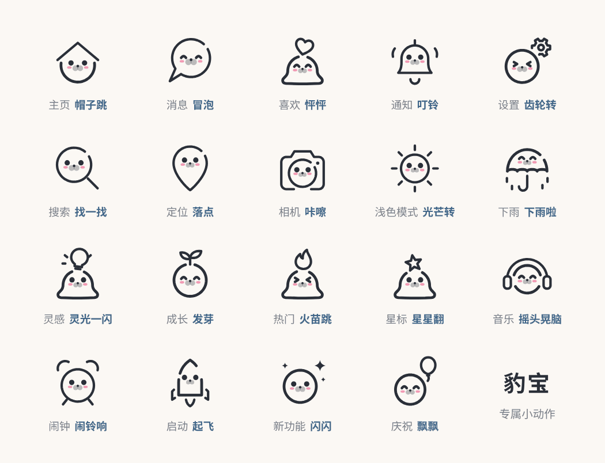

# 豹宝图标 · 动态版

111 个带海豹的图标都会动：醒来、睡着、待机眨眼、弹一下、脸红。其中 19 个还有自己的小动作，比如铃铛叮铃、齿轮转、下雨。


在线预览：`https://TangfanOVO.github.io/baobao-icons/motion/`

## 单个下载

在动态预览页的“单个下载”区域选择图标和动作，或点每个图标旁的“下载”。粗细、眼睛和速度跟随页面上方的选择；可以另选颜色、背景和 128 / 256 / 512 px 尺寸。

- **动态 SVG**：内嵌所需样式，无脚本、无外部依赖。打开即播放所选动作一次，待机动作循环；可作为图片使用。四周留有动作空间，半透明嘴筒和腮红原样保留。
- **GIF**：循环播放所选动作，在浏览器本地生成，有进度与取消按钮。生成后可再次点击保存链接；不需要上传图标。
- GIF 只支持完全透明或不透明，透明 GIF 的半透明边缘按白底处理；深色主题建议选深色背景或动态 SVG。
- 文件名包含图标、粗细、眼睛、动作、尺寸和速度。文件生成不等于已保存，手机端请确认浏览器的保存结果。

以下用法面向需要通过代码切换状态的开发者，使用的是 `motion/svg/` 里的源文件，与网页导出的独立动态 SVG 不同。

## 文件在哪

```
motion/
  svg/
    thin/               细线 · 豆豆眼
    thick/              粗线 · 豆豆眼
    thin-highlight/     细线 · 高光眼
    thick-highlight/    粗线 · 高光眼
  baobao-motion.css     所有动作
  baobao-motion.js      一个很小的播放助手（不用也行）
  motion.json           图标列表，哪些有专属动作
  index.html            预览页
```

动态版的文件名和静态版一样，例如 `motion/svg/thin/seal-home.svg`。

## 怎么用

`motion/svg/` 中的源 SVG 需要**直接贴进网页**，配合样式与助手切换状态；放进 `` 不能由外面的代码控制。预览页导出的动态 SVG 已经自带样式，可以放进 `` 自动播放。

### 1. 引入样式和助手

```html
<link rel="stylesheet" href="https://cdn.jsdelivr.net/gh/TangfanOVO/baobao-icons@main/motion/baobao-motion.css">
<script src="https://cdn.jsdelivr.net/gh/TangfanOVO/baobao-icons@main/motion/baobao-motion.js"></script>
```

### 2. 把 SVG 的内容贴进 HTML

打开 `motion/svg/thin/seal-home.svg`，把整段 `<svg …>…</svg>` 复制进页面。改颜色用 CSS `color`，改大小用 `width` / `height`。

### 3. 让它动

```js
const icon = document.querySelector("#home-tab svg");
BaobaoMotion.play(icon, "wake");    // 醒来
BaobaoMotion.play(icon, "sleep");   // 睡着
BaobaoMotion.play(icon, "bounce");  // 弹一下
BaobaoMotion.play(icon, "blush");   // 脸红
BaobaoMotion.play(icon, "trick");   // 专属动作（有的图标才有）
BaobaoMotion.asleep(icon, true);    // 直接睡着，不播动画
BaobaoMotion.idle(icon, true);      // 待机：慢慢呼吸，偶尔眨眼
```

不想用助手的话，直接改 `<svg>` 上的 class 也一样：

| class | 作用 |
| --- | --- |
| `is-asleep` | 睡着的样子（静止状态） |
| `idle` | 待机：呼吸和眨眼，一直循环 |
| `do-wake` / `do-sleep` | 醒来 / 睡着 |
| `do-bounce` / `do-blush` / `do-trick` | 弹一下 / 脸红 / 专属动作 |

同一个 `do-*` class 想再播一次，要先去掉，再加回来。

### tab 栏的例子

没选中的 tab 睡着，被选中的醒过来，再点一下已经选中的会弹一下：

```js
let current = document.querySelector(".tab.active");
document.querySelectorAll(".tab").forEach(tab => {
  if (tab !== current) BaobaoMotion.asleep(tab, true);
  tab.addEventListener("click", () => {
    if (tab === current) return BaobaoMotion.play(tab, "bounce");
    BaobaoMotion.play(current, "sleep");
    BaobaoMotion.play(tab, "wake");
    current = tab;
  });
});
```

### React / Vue

用 SVGR（React）或 vite-svg-loader（Vue）把 SVG 转成组件时，class 会原样保留。拿到组件的 ref 后调用 `BaobaoMotion.play(ref.current, "wake")`。

## 几点注意

- **跳起来会超出 24 格一点。** 弹一下和醒来时，最高的图标会往上多出约 3 格。文件里已经写了 `overflow="visible"`，别让外层容器把它裁掉就好。
- **没加样式时是静止的。** 没有引入 `baobao-motion.css` 时，动态版看起来和静态版的醒着状态一样。
- **减少动态。** 系统打开“减少动态”后，助手会直接跳到动作结束的样子，待机动画也会停下。
- **App。** 动态版现在是网页用的 CSS 动画。App 里常用的 Lottie 版以后再做。

## 专属动作

| 图标 | 动作 |
| --- | --- |
| 搜索 `seal-search` | 找一找 |
| 消息 `seal-chat` | 冒泡 |
| 通知 `seal-bell` | 叮铃 |
| 相机 `seal-camera` | 咔嚓 |
| 定位 `seal-location` | 落点 |
| 浅色模式 `seal-sun` | 光芒转 |
| 喜欢 `seal-heart` | 怦怦 |
| 星标 `seal-star` | 星星翻 |
| 灵感 `seal-bulb` | 灵光一闪 |
| 热门 `seal-fire` | 火苗跳 |
| 主页 `seal-home` | 帽子跳 |
| 音乐 `seal-music` | 摇头晃脑 |
| 设置 `seal-settings` | 齿轮转 |
| 下雨 `seal-umbrella` | 下雨啦 |
| 成长 `seal-sprout` | 发芽 |
| 闹钟 `seal-alarm` | 闹铃响 |
| 启动 `seal-rocket` | 起飞 |
| 新功能 `seal-sparkles` | 闪闪 |
| 庆祝 `seal-balloon` | 飘飘 |

## 授权

豹宝图标 © 2026 唐幡，按 [CC BY-NC 4.0](https://creativecommons.org/licenses/by-nc/4.0/deed.zh-hans) 授权，和静态版相同：可以免费用在个人和非商业项目里，使用时请署名“豹宝图标 by @唐幡”；商业用途请先联系作者。

---

## English

The motion edition: all 111 seal icons can wake up, fall asleep, idle (breathing and blinking), bounce and blush, and 19 of them have a trick of their own. Download a self-contained animated SVG or a looping GIF from the preview page. For interactive state changes, paste a source SVG from `motion/svg/` inline, include `baobao-motion.css`, then call `BaobaoMotion.play(svg, "wake" | "sleep" | "bounce" | "blush" | "trick")` from `baobao-motion.js`, or toggle the `is-asleep`, `idle` and `do-*` classes on the `<svg>` yourself. Same license as the static set: CC BY-NC 4.0. The GIF encoder is gifenc 1.0.3 (MIT), vendored with its license in `vendor/`.
